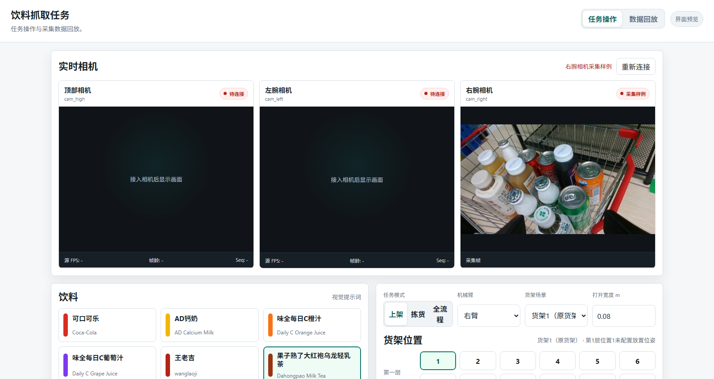
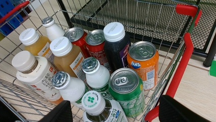
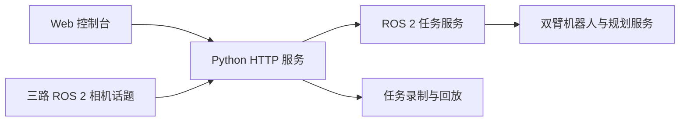

# Drink Grasp Web

面向双臂饮料上架与拣货任务的 ROS 2 Web 控制台。一个服务提供任务操作、三路相机监看、任务录制与数据回放。



界面预览使用真实采集的右腕相机画面；预览中的相机状态与任务控件仅用于展示页面布局。

## 功能

- **任务操作**：按饮料、货架位置和任务模式发起上架或拣货服务调用，显示执行状态与停止控制。
- **双臂全流程**：按左臂上架、转场检查、右臂拣货的顺序执行；阶段失败或停止时终止后续动作。
- **三路相机**：订阅顶部、左腕、右腕压缩图像话题，通过同一 Web 服务提供 MJPEG 画面与相机状态。
- **采集与回放**：录制任务相关的 ROS 话题，检查画面质量，并在页面中浏览已采集的 episode。

### 右腕相机采集样例



## 系统结构



主要文件：`server.py` 提供 HTTP API 与 ROS 2 服务桥接；`full_flow.py` 实现双臂阶段编排和配置校验；`live_cameras.py` 管理图像订阅与 MJPEG 输出；`playback.py`、`recording_quality.py` 处理 episode 回放与录制质量；`static/` 是浏览器界面。

## 部署

需要 ROS 2 Jazzy，以及提供 `graspnet_bridge_interfaces` 和任务规划服务的 ROS 工作空间。相机话题默认使用 `/cam_high`、`/cam_left`、`/cam_right` 下的压缩彩色图像。机器人位姿、货架参数和服务名称应按实际系统配置。

```bash
git clone https://github.com/GuanliLee/drink_grasp_web.git
cd drink_grasp_web

export DRINK_GRASP_BRIDGE_SETUP=/path/to/grasp_bridge/install/setup.bash
export DRINK_GRASP_PLANNING_SETUP=/path/to/planning_service/install/setup.bash
export DRINK_GRASP_OMPL_ROUTE_DIR=/path/to/planning_service/config/ompl_waypoints

./start.sh
```

打开 `http://127.0.0.1:8090/`，停止服务运行 `./stop.sh`。`DRINK_GRASP_ROS_SETUP` 可指定其他 ROS 2 安装的 `setup.bash`；`DRINK_GRASP_PORT` 可修改监听端口。启动前请校准 `config/` 中的机器人位姿与货架配置。

相机话题可通过 `DRINK_GRASP_CAM_HIGH_TOPIC`、`DRINK_GRASP_CAM_LEFT_TOPIC`、`DRINK_GRASP_CAM_RIGHT_TOPIC` 设置。`DRINK_GRASP_LIVE_CAMERAS_ENABLED=0` 可关闭实时相机订阅。录制目录由 `DRINK_GRASP_RECORD_DIR` 指定，默认使用项目下的 `recordings/`。

## 测试

核心流程、相机与录制质量的单元测试位于 `tests/`。在已安装 Python 测试依赖与 ROS 2 消息包的环境中运行：

```bash
python3 -m pytest tests
```

## 配置提示

`config/` 中的位姿是特定机器人与场景的配置样例。实际执行前，应核对坐标系、关节限位、货架位置、抓取路线和停止机制。`start.sh` 使用环境变量连接外部 ROS 工作空间，运行时日志、PID 文件和录制数据由 `.gitignore` 排除。
